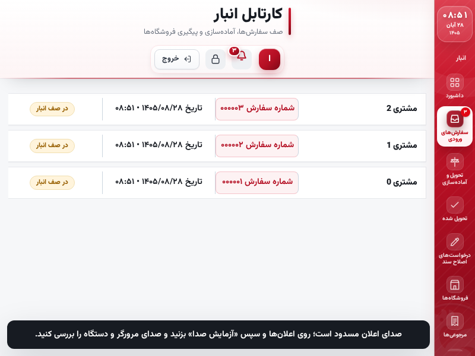
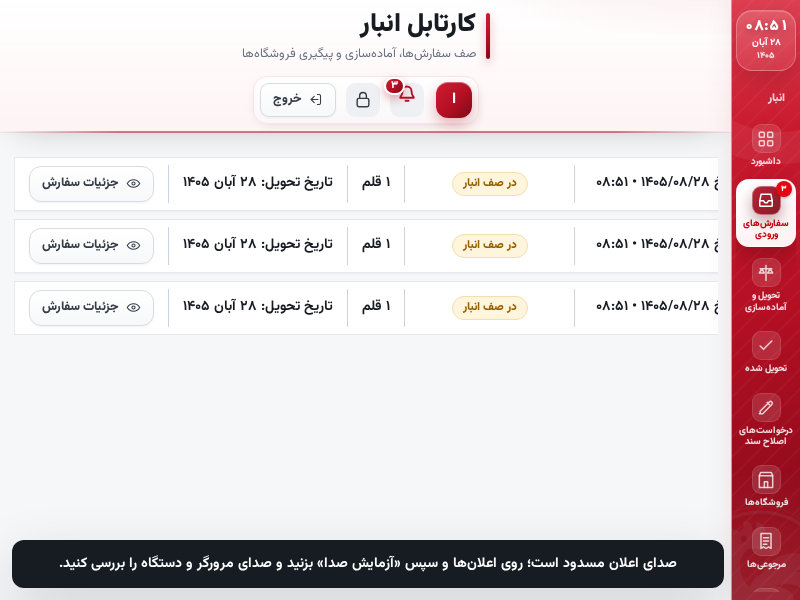
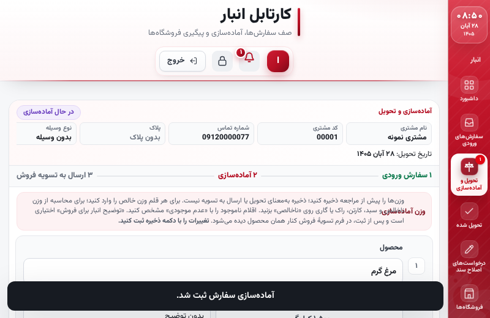
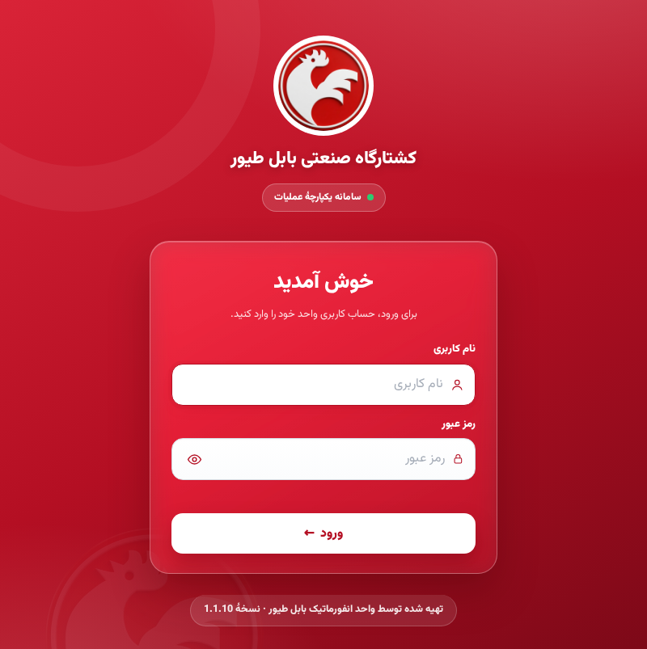
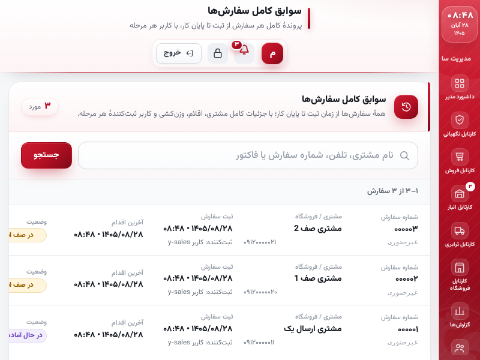
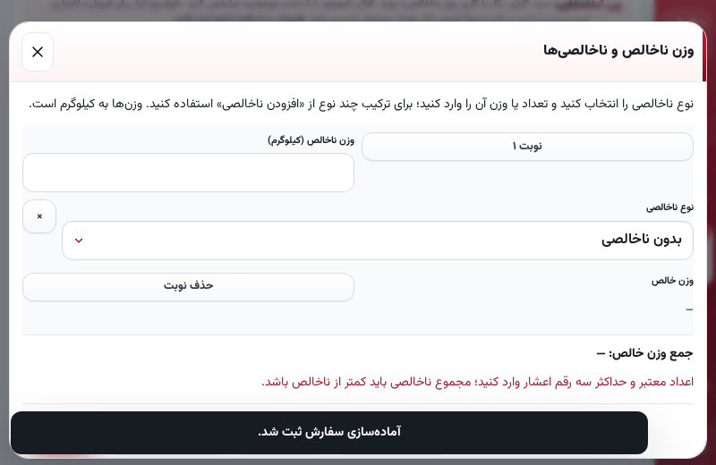
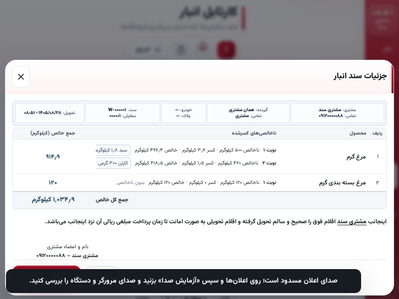

# بررسی علت نارسپانسیو بودن سامانه در مانیتور ۸۰۰×۶۰۰

**نسخهٔ بررسی‌شده:** ۱.۱.۱۰ (`main` = `f905e5e`) • **تاریخ:** ۲۸ آبان ۱۴۰۵
**روش:** اجرای واقعی سامانهٔ همین نسخه در مرورگر با اندازهٔ پنجرهٔ ۸۰۰×۶۰۰ (و ۸۰۰×۵۲۰ = ارتفاع واقعی مرورگر روی مانیتور ۸۰۰×۶۰۰)، اندازه‌گیری عرض واقعی هر جزء و مقایسه با عرض کادر دید، در همهٔ کارتابل‌ها.

---

## پاسخ کوتاه

سامانه در ۸۰۰×۶۰۰ **نارسپانسیو نیست چون «موبایل‌سازی» ندارد؛ نارسپانسیو است چون ردیف‌های کارتابلی به‌زور در یک «خط فشردهٔ دسکتاپ» قفل شده‌اند**:

1. **ردیف‌های کارتابل با عرض ثابت ۹۰۰ تا ۱۲۳۳ پیکسل رندر می‌شوند و در هیچ عرضی نمی‌شکنند.** قاعدهٔ `public/compatibility.css:1192` (و ۱۲۱۱ برای ردیف‌های فشرده) عرض را `width:max-content` و شکستن را `flex-wrap:nowrap` و ارتفاع را `54px` قفل کرده و برای هر سلول `min-width:140…256px` گذاشته است (خطوط ۱۴۹۶ تا ۱۵۰۲). نتیجه: ردیف انبار ۱۱۰۶ پیکسل اندازه‌گیری شد — **هم در ۱۲۸۰ پیکسل، هم در ۸۰۰، هم در ۳۷۵ پیکسل، بی‌تغییر**.
2. **اسکرول افقی صفحه خاموش است** (`public/styles.css:57`: `html,body{…overflow-x:hidden}` و `mobile.css:20`/`responsive.css:5`: `overflow-x:clip`). پس به‌جای یک نوار افقی در صفحه، هر فهرست یک نوار افقی ۸ پیکسلی جداگانه دارد (`.order-compact-scroll{overflow-x:auto}` در `compatibility.css:951`؛ ارتفاع نوار در `theme.css:85` فقط ۸ پیکسل است) و کاربر برای رسیدن به دکمه‌های عملیات باید **هر ردیف را جداگانه افقی بکشد**.
3. **شکاف بریک‌پوینت:** پوسته در ۱۰۲۴ پیکسل به «ریل آیکونی ۶۸ پیکسلی» تغییر می‌کند و فرم‌ها در ۹۰۰/۷۶۸ بازچینش می‌شوند، ولی **ردیف‌های کارتابلی هیچ بریک‌پوینتی ندارند**. یعنی دقیقاً در بازهٔ ۷۶۹ تا ۱۱۵۰ پیکسل (که ۸۰۰×۶۰۰ داخل آن است) قالب «ریل موبایل + ردیف‌های دسکتاپ» ترکیب می‌شود و بدترین حالت ممکن رخ می‌دهد.
4. **ارتفاع ۶۰۰ هم کم است:** در ارتفاع واقعی مرورگر (~۵۲۰ پیکسل) دکمه‌های اصلی برگهٔ «آماده‌سازی و تحویل» (ناخالصی، ذخیره وزن‌ها، ارجاع به فروش، ثبت وزن و چاپ سند) حدود ۴۷۰ پیکسل پایین‌تر از کادر دید هستند و دکمهٔ «ورود» در صفحهٔ لاگین ۳۵ پیکسل زیر خط دید می‌افتد؛ نوار پیام پایین صفحه هم روی ردیف آخر می‌افتد.

این رفتار **رگرسیون ۱.۱.۱۰ نیست**: همان قاعده‌ها در ۱.۱.۷ و ۱.۱.۹ هم عیناً وجود دارند (لایهٔ «ردیف فشردهٔ دسکتاپ» نسخهٔ ۳۷٫۴۹).

---

## ۱) اعداد اندازه‌گیری‌شده (۸۰۰×۶۰۰، عرض مفید محتوا = ۷۰۴ پیکسل)

| صفحه / جزء | عرض واقعی ردیف | عرض کادر دید | اضافه | چطور دیده می‌شود |
|---|---|---|---|---|
| کارتابل انبار → سفارش‌های ورودی (`wh38-card` / `order-compact-row`) | **۱۱۰۶px** | ۷۰۴px | **+۵۷٪** (۴۰۲px اسکرول) | دکمهٔ عملیات بیرون کادر |
| کارتابل انبار → آماده‌سازی (`wh38-card` / `order-summary-row`) | **۱۲۲۶px** | ۷۰۴px | **+۷۴٪** (۵۲۲px) | ۲ دکمه + ستون توضیح بیرون کادر |
| فروش → فرم سفارش غیرحضوری، «صف تلفنی» (`phone-queue-card-v40`) | **۱۲۳۳px** | ۶۶۶px | **+۸۵٪** (۵۶۷px) | دکمه‌های هر کارت بیرون کادر |
| مدیریت → سوابق سفارش‌ها (`adm-order-row`) | **۹۰۰px** | ۷۰۲px | **+۲۸٪** | دکمهٔ مشاهده بیرون کادر |
| برگهٔ آماده‌سازی → نوار مشخصات مشتری (`bt-customer-strip-scroll`) | **۱۰۱۰px** | ۶۷۸px | **+۴۹٪** | فیلدهای پلاک/وسیله بیرون کادر |
| همان ردیف انبار در ۱۰۲۴×۷۶۸ | ۱۱۰۶px | ۹۲۸px | +۱۹٪ | اسکرول افقی |
| همان ردیف انبار در ۱۲۸۰×۸۰۰ | ۱۱۰۶px | ۹۸۴px | +۱۲٪ | اسکرول افقی |
| همان ردیف انبار در ۳۷۵×۶۶۷ (موبایل) | ۱۱۰۶px | ۳۵۵px | **+۲۱۲٪** | همان مشکل، بدتر |

یعنی مشکل مخصوص ۸۰۰×۶۰۰ نیست؛ **در ۱۲۸۰ هم هست**، ولی در ۸۰۰×۶۰۰ به شکل «اصلاً کار نمی‌کند» دیده می‌شود چون تقریباً دو سوم هر ردیف بیرون کادر است.

### ارتفاع (۸۰۰×۵۲۰)

| مورد | اندازه |
|---|---|
| دکمه‌های اصلی برگهٔ آماده‌سازی («ناخالصی»، «ذخیره وزن‌ها»، «ارجاع به فروش»، «ثبت وزن، تحویل و چاپ سند») | هر چهارتا زیر خط دید؛ ۴۷۰px اسکرول عمودی |
| دکمهٔ «ورود» صفحهٔ لاگین در ۸۰۰×۶۰۰ | `top=635px` با ارتفاع دید ۶۰۰ → ۳۵px زیر خط دید |
| ارتفاع کل صفحهٔ لاگین | `scrollHeight=803px` |
| نوار پیام (toast) پایین صفحه | روی ردیف/دکمه‌های انتهای صفحه می‌افتد |

---

## ۲) ریشهٔ فنی، دقیق

| # | فایل:خط | قاعده | اثر |
|---|---|---|---|
| ۱ | `public/compatibility.css:1192` | `:is(.order-summary-row,.sales-delivery-summary-row){…flex-wrap:nowrap!important;width:max-content!important;height:54px!important…}` | عرض ردیف = مجموع عرض سلول‌ها؛ هرگز نمی‌شکند |
| ۲ | `public/compatibility.css:1193` | سلول‌ها: `flex:0 0 auto!important;white-space:nowrap!important` | سلول‌ها فشرده نمی‌شوند |
| ۳ | `public/compatibility.css:1211-1215` | `.order-compact-row{…width:max-content!important;flex-wrap:nowrap!important}` | همان قفل برای کارتابل ورودی انبار |
| ۴ | `public/compatibility.css:1498-1502` | `min-width` ثابت: هویت ۲۰۰، کد ۱۴۰، تاریخ ۱۹۰، وضعیت ۱۷۰، اکشن‌ها `nowrap` | جمع ≈ ۱۰۰۰ تا ۱۲۳۳px |
| ۵ | `public/compatibility.css:951` | `.order-compact-scroll{overflow-x:auto}` | اسکرول فقط داخل همان فهرست |
| ۶ | `public/styles.css:57` | `html,body{…overflow-x:hidden}` | نوار افقی صفحه حذف می‌شود؛ نارسپانسیو «پنهان» می‌شود |
| ۷ | `public/theme.css:85` | `::-webkit-scrollbar{height:8px}` | نوار افقی نازک و گم‌شدنی، مخصوصاً وقتی فهرست ارتفاع محدود دارد |
| ۸ | `public/mobile.css:7,59` | `--mobile-rail-width:68px` + `@media(max-width:1024px)` ریل باریک | در ۸۰۰px ریل ۶۸px از عرض کم می‌کند (۶۸ + padding) و برچسب‌ها سه‌خطی می‌شوند |
| ۹ | `public/compatibility.css:1341` | `.wh-weight-line{…min-width:780px}` | در ۸۰۰px مودال وزن‌کشی دقیقاً ۷۸۰px می‌شود (اما در ≤۱۱۵۰ بازچینش دارد، پایین را ببینید) |
| ۱۰ | `public/compatibility.css:1482` | `.sales-distribution-table{min-width:1000px}` | جدول تخصیص/پخش در ۸۰۰px اسکرول افقی می‌خواهد |
| ۱۱ | `public/compatibility.css:1491` | `#remoteFullEdit .remote-edit-table{min-width:650px}` | ویرایش کامل سفارش |

**چرا قواعد ریسپانسیو موجود جلوی این‌ها را نمی‌گیرند؟**
`compatibility.css` **آخرین** فایل CSS بارگذاری‌شده است (`public/index.html` خط ۲۳) و تقریباً همهٔ قواعدش `!important` دارند. `mobile.css` و `theme.css` هیچ قاعده‌ای برای `.order-summary-row` / `.order-compact-row` ندارند (بررسی شد؛ صفر مورد). تنها دو بازچینش موجود در همان فایل آخر این‌ها هستند و **محدود**اند:

- `compatibility.css:1416` — فقط `[data-store-section=history]` و فقط زیر ۶۰۰px.
- `compatibility.css:1508` — فقط اقلام برگهٔ آماده‌سازی (`.wh38-prep-item`) زیر ۱۱۵۰px (همین باعث می‌شود اقلام برگهٔ انبار خوب بچینند).

یعنی «قرارداد ریسپانسیو» برای ردیف‌های کارتابلی هیچ‌جا نوشته نشده است؛ هر اصلاحی هم باید **در همان فایل آخر و با همان قدرت `!important`** نوشته شود، وگرنه اعمال نمی‌شود.

---

## ۳) شواهد تصویری (۸۰۰×۶۰۰)

**کارتابل انبار — حالت اول (شروع ردیف):** دکمه‌های عملیات سمت چپ ردیف، بیرون کادر.

**همان ردیف پس از ۴۰۲ پیکسل اسکرول افقی:** تازه دکمه‌ها پیدا می‌شوند و ابتدای ردیف (مشتری/شماره) از دست می‌رود.

**فروش — صف تلفنی داخل فرم سفارش غیرحضوری:** تصویر زیر «همان چیزی است که کاربر در کادر ۶۶۶ پیکسلی می‌بیند» از کارتی که ۱۲۳۳ پیکسل عرض دارد؛ نیمهٔ چپ کارت (دکمه‌های عملیات) بیرون کادر است.

**برگهٔ آماده‌سازی در ارتفاع واقعی ۵۲۰px:** دکمه‌های اصلی زیر خط دید.

**صفحهٔ ورود ۸۰۰×۶۰۰:** دکمهٔ «ورود» ۳۵px زیر خط دید.

**مدیریت — سوابق سفارش‌ها (ردیف ۹۰۰px):**

---

## ۴) چیزهایی که درست کار می‌کنند (برای محدودکردن دامنهٔ اصلاح)

- **مودال وزن‌کشی و ناخالصی:** زیر ۱۱۵۰px بازچینش می‌شود؛ در ۸۰۰×۵۲۰ مودال ۷۸۰×۴۸۹ با دکمهٔ «تأیید وزن» در دید.
  
- **مودال «جزئیات سند انبار»:** جدول ۷۵۰px داخل مودال ۷۸۰px، فقط سلول ناخالصی‌ها اسکرول داخلی دارد.
  
- **داشبوردها، فرم‌های ورود اطلاعات، کارتابل نگهبانی، ترابری، مشتریان:** بازچینش دوستونه/تک‌ستونه درست انجام می‌شود و سرریز افقی ندارند (اندازه‌گیری: بدون سرریز).

پس مشکل، **محدود و مشخص** است: ردیف‌های فهرستی (کارتابل‌ها) + نوار مشخصات مشتری + چند جدول با `min-width` ثابت + ارتفاع صفحهٔ ورود و نوار عملیات برگهٔ انبار.

---

## ۵) اصلاحات پیشنهادی (به‌ترتیب اثر)

1. **بازچینش ردیف‌های کارتابلی زیر ۱۱۵۰px** — یک بلوک `@media(max-width:1150px)` در **انتهای** `compatibility.css` (بعد از خط ۱۵۰۲) با همان قدرت `!important`:
   `.order-summary-row,.order-compact-row,.phone-queue-card-v40` → `display:grid!important;grid-template-columns:repeat(2,minmax(0,1fr));width:100%!important;min-width:0!important;max-width:100%!important;height:auto!important;max-height:none!important;white-space:normal!important`؛ سلول‌ها `min-width:0!important;height:auto!important;border-inline-start:0!important;justify-content:flex-start!important`؛ ستون اکشن‌ها `grid-column:1/-1` با دو دکمهٔ مساوی. الگوی آمادهٔ همین کار در خط ۱۴۱۶ و ۱۵۰۸ موجود است.
2. **حذف اسکرول افقی تودرتو** در همان بریک‌پوینت: `.order-compact-scroll{overflow-x:visible!important}` (و اگر جایی لازم شد، نوار اسکرول ضخیم‌تر و همیشه‌پیدا).
3. **جدول تخصیص پخش:** `min-width:1000px` زیر ۹۰۰px به کارت/دو ستون تبدیل شود.
4. **صفحهٔ ورود:** زیر ۹۰۰px ارتفاع هیرو و فاصله‌ها کم شود تا دکمهٔ ورود بالای خط دید بیاید (`login-stage` فعلاً ۸۰۳px ارتفاع دارد).
5. **ارتفاع:** `position:sticky` برای `.modal-actions` و نوار عملیات برگهٔ آماده‌سازی؛ `padding-bottom` برای `#content` تا نوار پیام روی دکمه‌ها نیفتد.
6. **ریل ۶۸px:** زیر ۱۰۲۴px برچسب‌ها سه‌خطی می‌شوند؛ یا عرض به ~۸۴px برسد یا برچسب فقط با hover/focus نشان داده شود.
7. **ماتریس تست و جلوگیری از رگرسیون:** اسکرین‌شات/آزمون خودکار Playwright در ۸۰۰×۶۰۰ (و ۱۰۲۴×۷۶۸ و ۳۷۵×۶۶۷) با این قاعده: «عرض هر ردیف فهرستی ≤ عرض کادرش + ۱px». امروز این آزمون در ۸۰۰×۶۰۰ برای ۵ صفحه شکست می‌خورد.

---

## ۶) جمع‌بندی

- علت اصلی: **قفل‌شدن ردیف‌های فهرستی روی عرض ۹۰۰ تا ۱۲۳۳ پیکسل** در لایهٔ `compatibility.css` (خط ۱۱۹۲، ۱۲۱۱، ۱۴۹۶ تا ۱۵۰۲) بدون هیچ بریک‌پوینت بازچینش، به‌همراه خاموش‌بودن اسکرول افقی صفحه (`styles.css:57`).
- ۸۰۰×۶۰۰ بدترین حالت است چون در بازهٔ «ریل موبایل + ردیف دسکتاپ» می‌افتد؛ اما مشکل در ۱۲۸۰ پیکسل هم ۱۲ درصد سرریز دارد.
- ارتفاع ۶۰۰px هم دکمه‌های اصلی برگهٔ انبار و دکمهٔ ورود را زیر خط دید می‌برد.
- این وضعیت از ۱.۱.۷ تا ۱.۱.۱۰ یکسان است و رگرسیون نسخهٔ اخیر نیست.
- با اصلاح ۱ تا ۵ (فقط CSS و یک بلوک بریک‌پوینت در همان فایل آخر) عرض ردیف‌ها به عرض کادر دید می‌رسد؛ در یک آزمون سریع با بازچینش موقت، عرض ردیف انبار از ۱۱۰۶ پیکسل به ۷۰۴ پیکسل (عرض کادر در ۸۰۰×۶۰۰) رسید. اجرای کامل و بدون عارضهٔ آن نیاز به تنظیم دقیق سلول‌ها دارد که در قالب اصلاح پیشنهادی انجام می‌شود؛ آزمون خودکار بند ۷ هم اضافه می‌شود تا برنگردد.

> این گزارش فقط تحلیل است؛ هیچ کدی تغییر نکرده و نسخهٔ انتشار دست‌نخورده است.
