# پیشنهاد ساده‌تر و راحت‌تر کردن رابط کاربری (موبایل و دسکتاپ کوچک)

**نسخهٔ مبنا:** ۱.۱.۱۰ • **تاریخ:** ۲۸ آبان ۱۴۰۵
**دامنه:** فقط لایهٔ نمایش (CSS + چینش کامپوننت‌ها)؛ هیچ منطق کاری، محاسبهٔ وزن، مجوز یا گردش سفارش تغییر نمی‌کند.

---

## در یک نگاه — ۶ تصمیم که ۸۰٪ شلوغی را برمی‌دارد

1. **هر کارت، یک دکمهٔ اصلی.** هر ردیف/کارت فقط یک دکمهٔ پررنگ دارد و بقیهٔ عملیات داخل «⋯» می‌رود.
2. **کارت به‌جای ردیف پهن.** زیر ۱۱۵۰px، ردیف‌های افقی به کارت دوستونه با «برچسب: مقدار» تبدیل می‌شوند (دیگر اسکرول افقی لازم نیست).
3. **نوار عملیات چسبان.** دکمهٔ نهایی هر برگه (ثبت وزن، ثبت سفارش، تسویه) همیشه پایین صفحه و در دسترس است؛ نه ۴۷۰ پیکسل پایین‌تر.
4. **راهنما یک خط، بقیه پشت «راهنما».** متن‌های ۵ خطی حذف نمی‌شوند، جمع می‌شوند.
5. **ناوبری ساده:** موبایل = تب‌بار پایین با ۵ آیتم؛ دسکتاپ کوچک = ریل ۷۲px آیکونی با برچسب یک‌خطی.
6. **قاعدهٔ اندازه‌ها:** متن حداقل ۱۳px، دکمهٔ لمسی ۴۴px، فاصله‌های ۴/۸/۱۲/۱۶/۲۴ و حداکثر دو اندازه گردی.

**نتیجهٔ قابل اندازه‌گیری:** در ۸۰۰×۶۰۰ و ۳۷۵×۶۶۷ هیچ فهرستی اسکرول افقی نمی‌خواهد؛ ارتفاع هدر از ۱۳۳px به ۵۶px می‌رسد (۲۵٪ ارتفاع دید آزاد می‌شود)؛ دکمهٔ اصلی هر برگه همیشه در دید است.

---

## ۱) امروز دقیقاً چه چیزی «ناجور» است؟ (با عدد)

| موضوع | اندازه‌گیری امروز | چرا آزاردهنده است |
|---|---|---|
| هدر/سربرگ | **۱۳۳px** در ۸۰۰×۶۰۰ (≈۲۵٪ ارتفاع دید واقعی ۵۲۰px) | یک‌چهارم صفحه صرف عنوان و سه آیکون می‌شود |
| ردیف‌های فهرست | **۱۱۰۶ تا ۱۲۳۳px** عرض در کادر ۷۰۴px | هر ردیف باید افقی کشیده شود تا دکمه‌اش پیدا شود |
| سطح‌های عملیات | **۳ سطح**: آیکون‌های هدر + دکمه‌های ردیف + دکمه‌های فوتر برگه (۴ دکمه) | کاربر نمی‌داند «کار بعدی» کدام است |
| دکمه‌ها | ارتفاع **۳۰ تا ۳۲px** در دسکتاپ کوچک | زیر حد لمس (۴۴px) و سخت‌خوان |
| تایپوگرافی | در برگهٔ آماده‌سازی: **۲۳ عنصر ۱۲px** و **۷ عنصر ۱۰px** | ریز و پرتراکم؛ روی مانیتور ۸۰۰×۶۰۰ خواندنش خسته‌کننده است |
| متن‌های راهنما | بلوک ۵ خطی «وزن آماده‌سازی…» (≈۱۸۰px در موبایل) | بزرگ‌ترین بلوک صفحه، یک‌بار‌خواندنی است |
| راهنمای صفحه‌کلید در موبایل | پاراگراف ۵۳px دربارهٔ «Insert / کلیدهای جهت‌دار» | در موبایل بی‌معنی است و صفحه را شلوغ می‌کند |
| طول فرم‌ها | فرم سفارش غیرحضوری **۱۹۶۱px** (≈۳ صفحهٔ موبایل)، برگهٔ آماده‌سازی ۱۱۱۴ تا ۱۴۵۲px | پیمایش زیاد، بدون نشانگر مرحله |
| دکمهٔ نهایی | در ارتفاع ۵۲۰px، **۴۷۰px** زیر خط دید | کاربر فکر می‌کند «ثبتی وجود ندارد» |
| نوار پیام (toast) | پایین صفحه، روی ردیف/دکمهٔ آخر می‌افتد | پیام، خودش مانع کار می‌شود |
| ریل دسکتاپ کوچک | ۶۸px با برچسب‌های سه‌خطی | اسکن کردن منو کند است |

### «قبل» — نمونه‌های واقعی همین نسخه در ۸۰۰×۶۰۰

| فهرست انبار | صف تلفنی فروش | برگهٔ آماده‌سازی (ارتفاع ۵۲۰) |
|---|---|---|
| 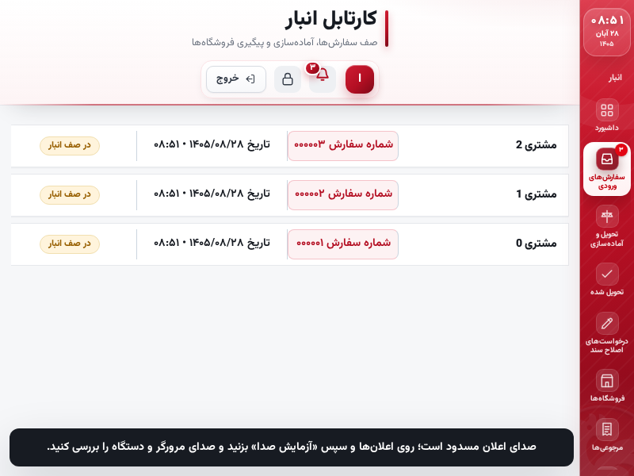 | 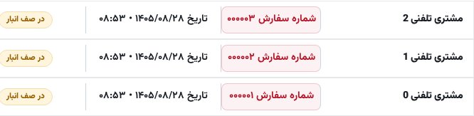 | 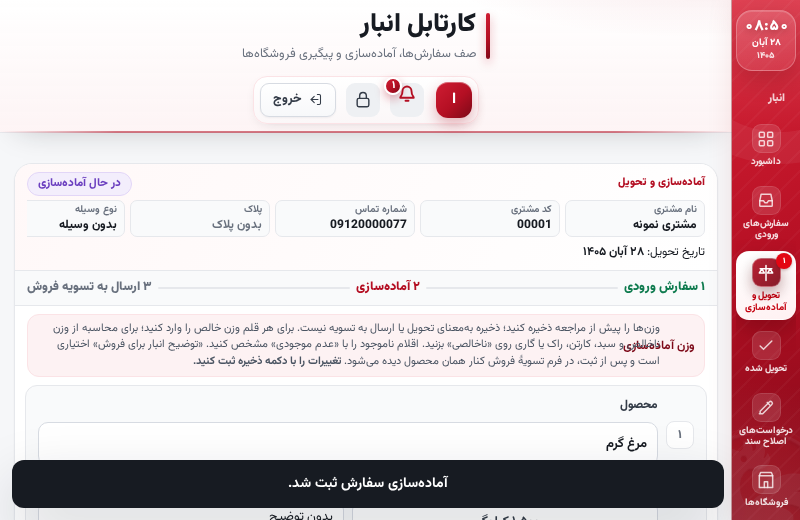 |

---

## ۲) شش اصل پیشنهادی

1. **یک کار، یک دکمه.** در هر کارت/برگه فقط یک دکمهٔ پررنگ. بقیه در «⋯» یا لینک متنی کمرنگ.
2. **محتوا به‌جای کادر.** کمتر خط و کادر؛ اطلاعات در «برچسب: مقدار» و چیپ وضعیت. هر کادر اضافی = یک تصمیم بصری اضافه برای کاربر.
3. **همیشه در دسترس.** دکمهٔ اصلی هر صفحه در نوار چسبان پایین؛ هیچ‌وقت زیر خط دید نمی‌رود.
4. **افشای تدریجی.** راهنما، فیلدهای تکمیلی (توضیح، پلاک، وسیله) و ستون‌های کم‌اهمیت به‌صورت پیش‌فرض بسته/پنهان؛ با یک لمس باز می‌شوند.
5. **یک زبان بصری.** دو شعاع گردی، دو سطح سایه، سه رنگ وضعیت (سبز/کهربایی/قرمز) + یک رنگ اصلی. حذف کادرهای تزئینی و رنگ‌های پراکنده.
6. **قاعدهٔ پیش‌فرض برای صفحه‌های کوچک.** هر کامپوننت از ابتدا برای ۳۷۵px طراحی می‌شود و بعد برای ۸۰۰/۱۴۰۰ گسترش می‌یابد (نه برعکس).

---

## ۳) سیستم طراحی: توکن‌ها و بریک‌پوینت‌ها

### توکن‌های پایه

| گروه | مقدارها |
|---|---|
| فاصله | ۴ / ۸ / ۱۲ / ۱۶ / ۲۴ (همهٔ padding و gapها فقط از این‌ها) |
| گردی | `10px` (کنترل)، `14px` (کارت)، `999px` (چیپ) |
| متن | ۱۱ (برچسب) / ۱۲ (کمکی) / ۱۴ (متن اصلی) / ۱۶ (ورودی و عنوان کارت) / ۲۰ (عنوان صفحه) |
| ارتفاع کنترل | **۴۴px** لمسی (زیر ۶۰۰px) / **۳۸px** ماوس (۶۰۰px+) |
| رنگ | اصلی `#b40f23`، متن `#1d2733`، کمکی `#6b7684`، خط `#e3e8ee`، زمینه `#f4f6f8`، موفق `#0f7a4d`، هشدار `#8a5a00`، اطلاع `#12508f` (هر کدام با پس‌زمینهٔ ۵٪) |
| سایه | سطح ۱ برای کارت، سطح ۲ فقط برای نوار عملیات شناور |
| اندازه‌های ثابت | هدر ۵۶px، تب‌بار ۵۶px، ریل دسکتاپ ۷۲px، حداقل هدف لمس ۴۴×۴۴ |

### بریک‌پوینت‌ها (فقط سه‌تا؛ بقیه حذف)

| بازه | چیدمان | ناوبری |
|---|---|---|
| ≤ ۵۹۹px (موبایل) | یک‌ستونه، کارت، نوار عملیات چسبان بالای تب‌بار، شیت تمام‌صفحه برای مودال‌ها | تب‌بار پایین ۵ آیتم |
| ۶۰۰ – ۱۰۲۴px (دسکتاپ کوچک/تبلت) | کارت‌های ۱ یا ۲ ستونه، همان نوار عملیات (شناور) | ریل ۷۲px آیکونی + برچسب یک‌خطی |
| ≥ ۱۰۲۵px (دسکتاپ) | شبکهٔ ۲ تا ۳ ستونه، جدول‌های کامل | ریل کامل ۲۰۰px |

> قاعدهٔ سخت: **هیچ ردیف/جدولی زیر ۱۱۵۰px عرض ثابت بیشتر از کادرش نداشته باشد.** (این یک آزمون خودکار می‌شود؛ بخش ۷.)

---

## ۴) الگوهای آماده (همین‌ها را می‌سازیم)

### الگوی ۱ — کارت صف سفارش (جایگزین ردیف ۱۱۰۶ پیکسلی)

```
┌───────────────────────────────────────────────┐
│ مشتری نمونه                        [در حال آماده‌سازی] │
│ ۰۹۱۲۰۰…  ·  بابل                                    │
│ ─────────────────────────────────────────────── │
│ شمارهٔ سفارش   تاریخ تحویل    اقلام                    │
│ ۰۰۰۰۱          ۲۸ آبان       ۲ قلم                    │
│ ┌─────────────────────────────┐  ┌────┐            │
│ │      ثبت وزن و تحویل          │  │ ⋯  │            │
│ └─────────────────────────────┘  └────┘            │
└───────────────────────────────────────────────┘
```
- سه خط، بدون اسکرول افقی، در هر عرضی.
- دکمهٔ اصلی تمام‌عرض؛ «⋯» برای: جزئیات سفارش، ارجاع به فروش، چاپ سند.

### الگوی ۲ — نوار عملیات چسبان
یک دکمهٔ ثانویهٔ کم‌رنگ + یک دکمهٔ اصلی، همیشه پایین صفحه؛ در موبایل بالای تب‌بار؛ با احتساب `safe-area` آیفون.

### الگوی ۳ — راهنمای یک‌خطی
به‌جای بلوک ۵ خطی: «وزن هر قلم را وارد کنید؛ ناخالصی از دکمهٔ «ناخالصی» کسر می‌شود. **راهنما**» — با کلیک، متن کامل باز می‌شود (و برای همیشه بسته می‌ماند).

### الگوی ۴ — ورودی وزن درشت + شیت ناخالصی
ورودی عددی ۴۴px با واحد کنارش و دکمهٔ «ناخالصی» در کنار؛ تعداد نوبت‌های ثبت‌شده به‌صورت چیپ («۲ نوبت») روی همان ردیف دیده می‌شود تا کاربر بداند چه چیزی ذخیره شده است.

### الگوی ۵ — جدول به کارت (زیر ۹۰۰px)
جدول‌های `min-width:1000px` (مثل تخصیص پخش و سوابق) به کارت با «برچسب: مقدار» تبدیل می‌شوند؛ در دسکتاپ همان جدول می‌ماند.

### الگوی ۶ — هدر و ناوبری
هدر ۵۶px: عنوان + ۳ آیکون (اعلان، حساب، منو). تاریخ/ساعت از هدر به داشبورد یا پایین ریل منتقل می‌شود (الان بخش زیادی از هدر را گرفته).

### «بعد» — پیش‌نمایش عملی (همین حالا در همین مخزن قابل دیدن است)

| موبایل ۳۷۵px | دسکتاپ کوچک ۸۰۰px |
|---|---|
| 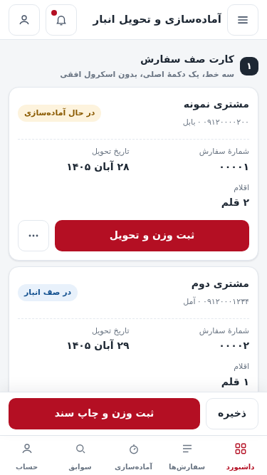 | 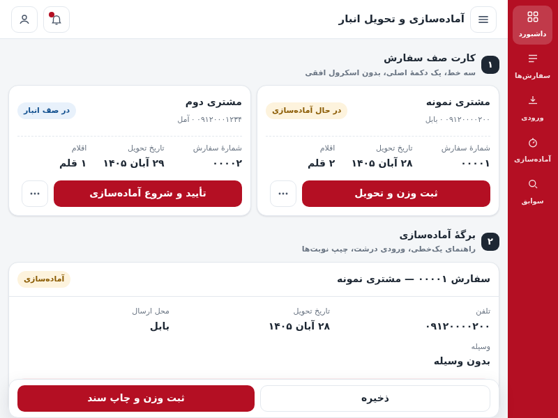 |

فایل زندهٔ پیش‌نمایش: [`docs/prototype/ui-compact.html`](prototype/ui-compact.html) — در مرورگر باز کنید و پنجره را کوچک/بزرگ کنید.

---

## ۵) صفحه‌به‌صفحه: چه چیزی حذف / ادغام / جابه‌جا می‌شود

| صفحه | امروز | پیشنهاد |
|---|---|---|
| **کارتابل انبار (ورودی/آماده‌سازی/تحویل‌شده)** | ردیف ۱۱۰۶–۱۲۲۶px، ۲ تا ۳ دکمه در انتهای ردیف، اسکرول افقی | کارت الگوی ۱؛ حذف ستون‌های کم‌اهمیت (کد مشتری، تعداد قلم) به خط دوم؛ فقط یک دکمه + «⋯» |
| **برگهٔ آماده‌سازی** | ۴ دکمهٔ فوتر + راهنمای ۵ خطی + نوار مشخصات ۱۰۱۰px | راهنمای یک‌خطی؛ مشخصات مشتری به ۲×۲؛ اقلام به کارت با ورودی درشت؛ نوار عملیات چسبان با ۲ دکمه (ذخیره / ثبت وزن و چاپ سند)؛ «ارجاع به فروش» داخل «⋯» |
| **فرم سفارش غیرحضوری** | ۱۹۶۱px، ۴ بخش بدون مرز مشخص، راهنمای کیبورد ۵۳px | سه گام شماره‌دار (مشتری → اقلام → ارسال) با هدر گام و «بعدی»؛ راهنمای کیبورد فقط در دسکتاپ؛ صف تلفنی به کارت الگوی ۱ |
| **تسویه** | جدول فاکتور ۷ ستونه با اسکرول، دکمه‌های ریز | کارت فاکتور با ۴ فیلد کلیدی + «جزئیات»؛ پرداخت در یک کارت جدا با یک دکمهٔ اصلی |
| **کارتابل نگهبانی** | ۱۱ فیلد، ۱۲۲۵px، دو ستون نامنظم | دو بخش: «وسیله» و «مراجعه»؛ فیلد پلاک با سه کادر به‌هم‌چسبیده و کیبورد مخصوص؛ دکمهٔ ثبت در نوار چسبان |
| **مدیریت (سوابق/کاربران/گزارش‌ها)** | ردیف ۹۰۰px، جدول‌های پهن | کارت/جدول تطبیقی؛ فیلترها در یک ردیف جمع‌شونده |
| **سند انبار (مودال)** | امروز خوب است (۷۵۰px داخل ۷۸۰px) | فقط: در موبایل تمام‌صفحه + نوار «چاپ/بستن» چسبان |

---

## ۶) دسترس‌پذیری و راست‌به‌چپ (قواعد سخت)

- حداقل هدف لمس **۴۴×۴۴** در هر عرضی زیر ۶۰۰px (امروز دکمه‌ها ۳۰px هستند).
- متن بدنه **حداقل ۱۳px**، برچسب‌ها **حداقل ۱۱px**؛ عدد وزن‌ها با فونت ۱۶px و ارقام فارسی.
- کنتراست: متن اصلی روی سفید ≥ ۷:۱؛ متن کمکی ≥ ۴٫۵:۱ (خاکستری `#6b7684` کافی است).
- ترتیب DOM = ترتیب خواندن RTL؛ آیکون‌ها `aria-hidden`، دکمه‌ها `aria-label` (مثل «⋯ → عملیات بیشتر»).
- فوکوس واضح (`:focus-visible` با حلقهٔ ۲px) برای کار با کیبورد در انبار.
- نوار پیام **بالای** نوار عملیات نمایش داده شود تا هیچ‌وقت روی دکمه نیفتد.

---

## ۷) نقشهٔ اجرا و معیار پذیرش

| فاز | کار | ریسک | اثر |
|---|---|---|---|
| **۱ (حداقلی)** | بلوک بریک‌پوینت در انتهای `compatibility.css`: ردیف‌ها → کارت؛ حذف اسکرول افقی؛ هدر ۵۶px | کم (فقط CSS) | رفع کامل اسکرول افقی و دکمه‌های بیرون کادر |
| **۲** | نوار عملیات چسبان + راهنمای یک‌خطی + تب‌بار موبایل | کم | دکمهٔ اصلی همیشه در دید؛ کاهش شلوغی |
| **۳** | فرم‌ها به گام‌های شماره‌دار + جدول‌به‌کارت (تسویه/سوابق) | متوسط (تغییر markup) | کاهش ۳۰–۴۰٪ پیمایش |
| **۴** | یکسان‌سازی توکن‌ها و حذف قواعد قدیمی متناقض (`!important`های تکراری) + پاک‌سازی CSS | متوسط | نگهداری آسان‌تر، پایان جنگ اولویت‌ها |

### معیار پذیرش (قابل آزمون)

1. در ۳۷۵×۶۶۷، ۸۰۰×۶۰۰، ۱۰۲۴×۷۶۸ و ۱۴۰۰×۹۰۰: **هیچ عنصری در `#content` عرضش از کادرش بیشتر نباشد** (آزمون خودکار).
2. در هر صفحه **حداکثر یک** دکمهٔ `primary` در دید باشد.
3. ارتفاع هدر ≤ ۶۴px؛ دکمهٔ اصلی هر برگه در ۱۰۰٪ اسکرول‌ها در دید (sticky).
4. همهٔ دکمه‌های لمسی ≥ ۴۴px؛ هیچ متنی < ۱۱px.
5. نوار پیام با هیچ دکمه‌ای هم‌پوشانی نداشته باشد.
6. اسکرین‌شات مرجع برای ۶ صفحه در ۲ عرض، در تست‌ها ذخیره شود تا رگرسیون سریع دیده شود.

---

## ۸) تصمیم با شما

| گزینه | زمان تقریبی | نتیجه |
|---|---|---|
| **الف) فاز ۱ و ۲** (پیشنهاد من) | کم — فقط CSS و چند تمپلیت | همان چیزی که در تصاویر «بعد» می‌بینید؛ مشکل ۸۰۰×۶۰۰ و موبایل حل می‌شود |
| **ب) فاز ۱ تا ۳** | متوسط | فرم‌های گام‌دار و جدول‌های کارتی هم اضافه می‌شود |
| **ج) فاز ۱ تا ۴** | بیشتر | بازنویسی کامل لایهٔ نمایش و پاک‌سازی CSS قدیمی |

> پیشنهاد من گزینهٔ **الف** است: با کمترین ریسک، بیشترین درد کاربر (شلوغی، دکمه‌های بیرون کادر، دکمهٔ نهایی زیر خط دید) را برمی‌دارد. اگر تأیید کنید، همان را با آزمون‌های بند ۷ پیاده می‌کنم و نسخهٔ بعدی را طبق روال بیرون می‌دهم.

---

### پیوست: فایل‌های مرتبط
- گزارش علت‌یابی نارسپانسیو بودن: [`docs/responsive-800x600-report-fa.md`](../responsive-800x600-report-fa.md)
- پیش‌نمایش زندهٔ پیشنهاد: [`docs/prototype/ui-compact.html`](prototype/ui-compact.html)


---

## پیوست تصویری: مقایسهٔ «قبل / بعد»

| # | موضوع | تصویر |
|---|---|---|
| ۰ | نمای کلی پوسته (موبایل + دسکتاپ کوچک) | 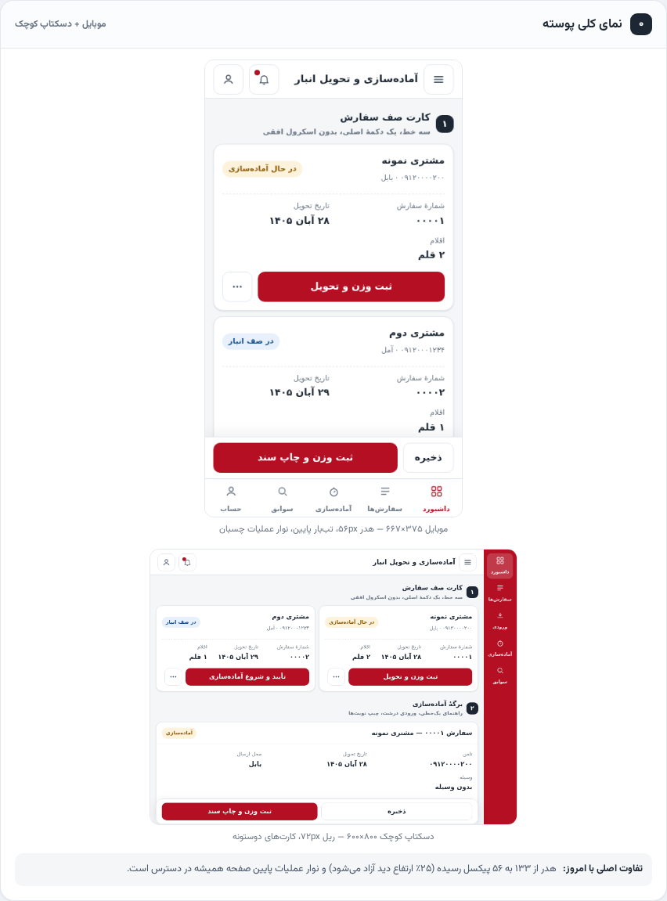 |
| ۱ | صف سفارش‌های انبار (۸۰۰px) | 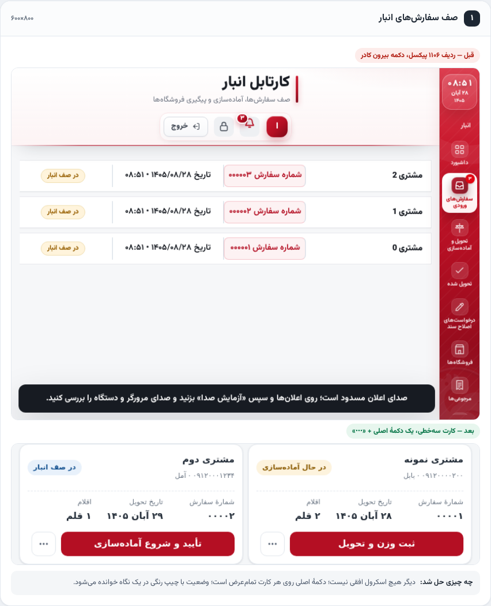 |
| ۲ | برگهٔ آماده‌سازی و وزن‌کشی (۳۷۵px) | 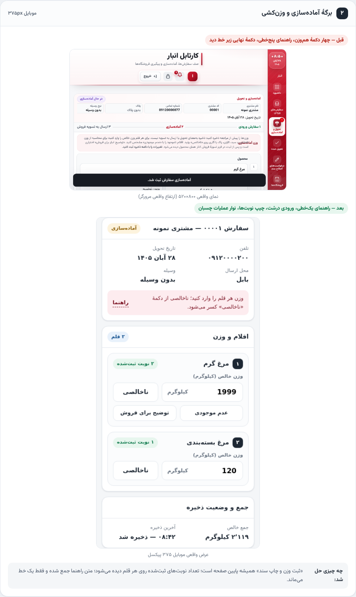 |
| ۳ | صف تلفنی داخل فرم فروش | 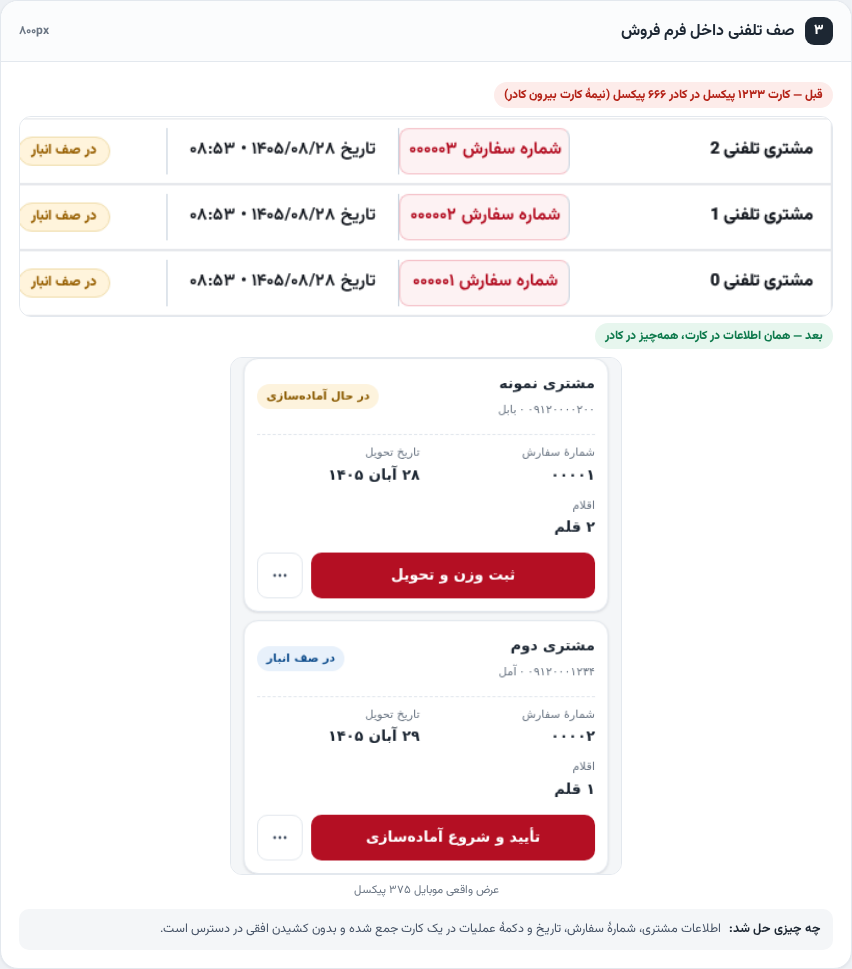 |
| ۴ | فرم چندبخشی → سه گام | 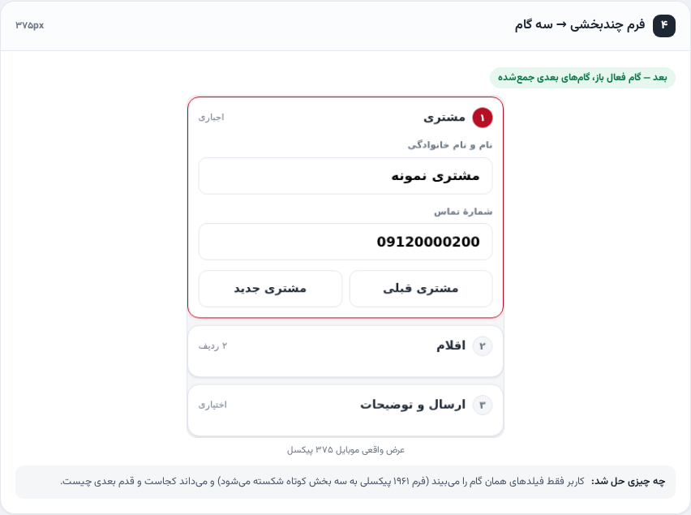 |
| ۵ | جدول → کارت و وضعیت‌ها | 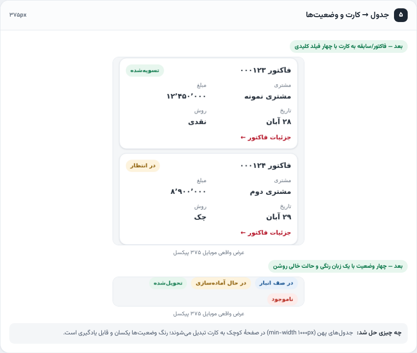 |

صفحهٔ مقایسهٔ کامل: [`docs/prototype/compare.html`](prototype/compare.html) — با مرورگر باز کنید.
