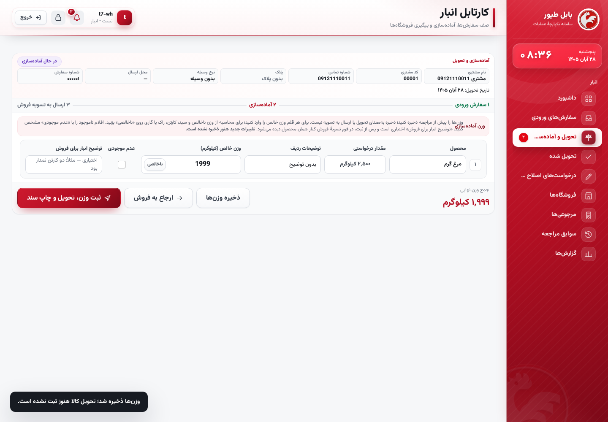
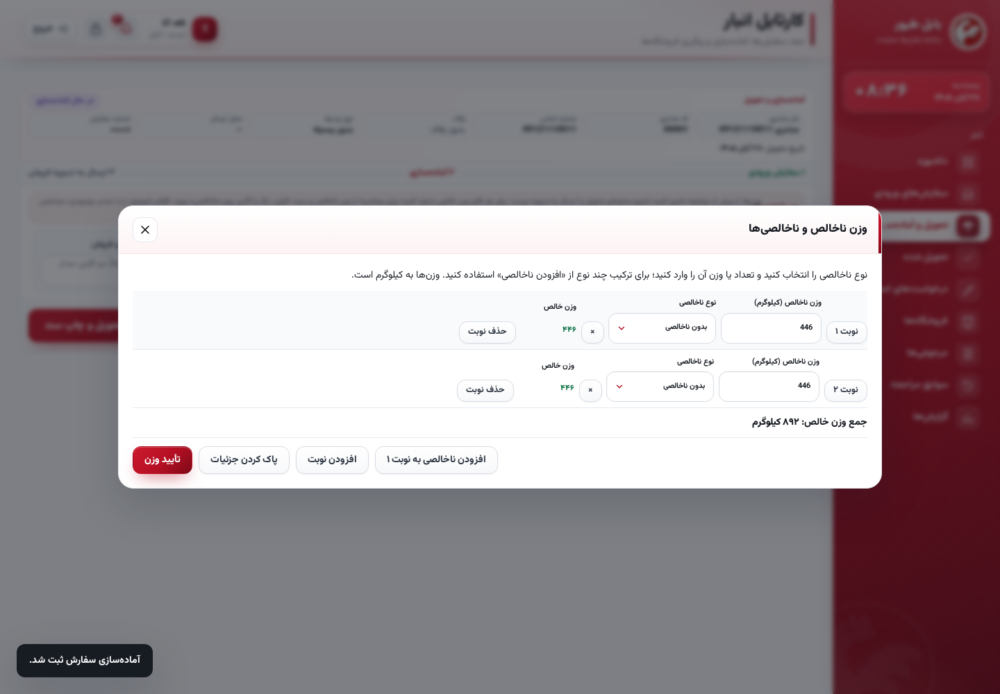

# گزارش علت‌یابی: چرا فقط دو نوبت ناخالصی در سند انبار ثبت شد؟

**نسخهٔ بررسی‌شده:** ۱.۱.۱۰ (`main` = `f905e5e`) • **تاریخ بررسی:** ۲۸ آبان ۱۴۰۵
**موضوع گزارش کاربر:** برای یک سفارش ۴ نوبت ناخالصی با وزن ۱۹۹۹ کیلوگرم ثبت شد، ولی سند انبار ۸۹۲ کیلوگرم (فقط ۲ نوبت) شد.

---

## پاسخ کوتاه

**۱) هیچ محدودیت «دو نوبت» در سامانه وجود ندارد.** این را در سه لایه بررسی و با آزمون واقعی روی همین نسخه اثبات کردم:

| لایه | محل | سقف واقعی |
|---|---|---|
| پنجرهٔ «وزن ناخالص و ناخالصی‌ها» | `ui-src/ui2/05-warehouse.js:417` | **۱۰۰ نوبت** برای هر قلم |
| انواع ناخالصی در هر نوبت | `ui-src/ui2/05-warehouse.js:378,415` | **۶ نوع** (سبد ۱٫۸، سبد ۲٫۵، کارتن ۳۰۰، کارتن ۶۰۰، راک، گاری) |
| اعتبارسنجی سرور | `lib/warehouse-weighing.js:7` | فهرست نوبت **۱ تا ۱۰۰** پذیرفته می‌شود |

نسخه‌های ۱.۱.۷، ۱.۱.۸، ۱.۱.۹ و ۱.۱.۱۰ را از تگ‌های مخزن مقایسه کردم؛ کد پنجرهٔ وزن‌کشی در ۱.۱.۹ و ۱.۱.۱۰ **بیت‌به‌بیت یکی است** (۵۰۵ خط) و در هیچ‌کدام سقف دو نوبت نبوده است. پس این موضوع «رگرسیون ۱.۱.۱۰» نیست.

**۲) علت واقعی: نوبت‌های ۳ و ۴ هیچ‌وقت از مرورگر بیرون نرفتند.** نوبت‌های وزن‌کشی تا لحظه‌ای که دکمهٔ «ذخیره وزن‌ها» یا «ثبت وزن نهایی» با موفقیت اجرا نشود، **فقط در حافظهٔ همان برگهٔ مرورگر** نگه داشته می‌شوند (`WeakMap` در `05-warehouse.js:371`). هر بار که برگهٔ «آماده‌سازی و تحویل» دوباره ساخته شود — باز کردن سفارش دیگر، رفتن و برگشتن به همین صفحه، رفرش/ورود مجدد، یا کار هم‌زمان دو کاربر روی همان سفارش — نوبت‌های ذخیره‌نشده **بی‌صدا** دور ریخته می‌شوند و سامانه فقط «آخرین پیش‌نویس ذخیره‌شده» را روی صفحه برمی‌گرداند.

در سفارش شما، آخرین پیش‌نویس ذخیره‌شده **۲ نوبت و ۸۹۲ کیلوگرم** بود؛ نوبت‌های ۳ و ۴ روی صفحه دیده می‌شدند (۱۹۹۹ کیلوگرم) ولی در سرور نبودند. «ثبت وزن نهایی» همان چیزی را که روی صفحه بود (۸۹۲ با ۲ نوبت) در سند نوشت.

**۳) حساب اختلاف:** ۱۹۹۹ − ۸۹۲ = **۱۱۰۷ کیلوگرم** = مجموع وزن خالص همان دو نوبتی که ثبت نشدند.

---

## ۱) قدم‌به‌قدم چه بررسی شد

1. **پنجرهٔ ثبت ناخالصی (کلاینت):** `ui-src/ui2/05-warehouse.js` خطوط ۳۶۸ تا ۴۳۵ — ساخت نوبت (`data-wt-line`)، افزودن نوبت (`[data-wt-add]` با سقف ۱۰۰)، افزودن ناخالصی به نوبت فعال (`[data-wt-add-tare]` با سقف ۶ نوع)، محاسبه (`calculate`) و «تأیید وزن» که نوبت‌ها را در `whWeighingDrafts` (یک `WeakMap` روی همان `input`) می‌گذارد.
2. **سرور:** `lib/warehouse-weighing.js` (`weighingsFor`: ۱ تا ۱۰۰ نوبت، محاسبه در گرم، ناخالصی‌های ثابت)، `lib/warehouse-weight-draft.js` (`prepare` + `checkRevision`)، `lib/routes/orders.js:625-660` (ثبت وزن نهایی: `kg = weighing.netKg`)، `lib/pickup-transaction-service.js:99`، `lib/routes/store-runs.js:99`.
3. **مسیر سند:** `lib/routes/orders.js:984-995` و `ui-src/ui2/05-warehouse.js:181-192` — سند، `deliveredKg` و «نوبت‌ها» را از همان رکورد نهایی می‌سازد؛ یعنی اگر در سرور ۲ نوبت باشد، سند هم ۲ نوبت و همان جمع را نشان می‌دهد.
4. **مقایسهٔ نسخه‌ها:** تارگت `v1.1.7` و `v1.1.9` از مخزن گرفته و فایل وزن‌کشی و ماژول سرور مقایسه شد → بدون محدودیت نوبت.
5. **آزمون واقعی مرورگر روی بیلد ۱.۱.۱۰** (نمونهٔ آزمایشی جداگانه، همان کد و همان دیتابیس‌ساز): ۵ سناریو، جدول زیر.

### نتیجهٔ آزمون‌های واقعی

| # | سناریو | نتیجه |
|---|---|---|
| ۱ | ۴ نوبت در یک نشست، هر نوبت با نوع ناخالصی متفاوت (سبد/کارتن/راک/گاری) | **موفق:** ۴ نوبت و ۱۹۹۹ کیلوگرم ذخیره و در سند ثبت شد |
| ۲ | ۲ نوبت ذخیره → بستن صفحه → ورود دوباره → افزودن ۲ نوبت دیگر → «ثبت وزن نهایی» | **موفق:** ۴ نوبت / ۱۹۹۹ کیلوگرم |
| ۳ | ۲ نوبت (۸۹۲) ذخیره → افزودن ۲ نوبت دیگر (صفحه ۱۹۹۹ نشان می‌دهد) → **بدون ذخیره** باز کردن سفارش دیگر و برگشت به همین سفارش | **شکست (بازتولید شد):** صفحه به ۸۹۲ و ۲ نوبت برگشت |
| ۴ | ادامهٔ سناریوی ۳ → «ثبت وزن نهایی» | **شکست:** سند انبار ۸۹۲ کیلوگرم با ۲ نوبت (همان گزارش شما) |
| ۵ | اپراتور دوم همان سفارش را باز کرد | همان «پیش‌نویس ذخیره‌شده» را می‌بیند (در حالت ۲: ۴ نوبت/۱۹۹۹؛ در حالت ۳: ۲ نوبت/۸۹۲) |

---

## ۲) سناریوی دقیق بازتولیدشده (با همان اعداد شما)

1. انبار دو نوبت را ثبت می‌کند (مثلاً ۴۴۶ + ۴۴۶ = ۸۹۲) و «ذخیره وزن‌ها» را می‌زند.
2. برای ادامهٔ کار، «ناخالصی» باز می‌شود؛ دو نوبت بعدی (۵۵۳٫۵ + ۵۵۳٫۵ = ۱۱۰۷) اضافه و «تأیید وزن» زده می‌شود. برگه **۱۹۹۹ کیلوگرم** نشان می‌دهد و متن ریز زیر جدول هم می‌گوید «تغییرات جدید هنوز ذخیره نشده است.»
   
3. اپراتور برای بررسی سفارش دیگری همان برگه را عوض می‌کند (یا صفحه را رفرش می‌کند / نشست قطع و وصل می‌شود / همکارش همان سفارش را باز می‌کند).
4. برگشت به سفارش اول: مقدار **۸۹۲** و در پنجرهٔ ناخالصی فقط **۲ نوبت**.
   
5. «ثبت وزن نهایی» → سند انبار ۸۹۲ کیلوگرم با دو نوبت؛ پیش‌نویس هم پاک می‌شود (`warehouseWeightDraft=null`) و دیگر قابل بازیابی نیست. ۱۱۰۷ کیلوگرم گم می‌شود.

---

## ۳) ریشهٔ فنی (دقیق)

- **نوبت‌ها فقط در حافظهٔ مرورگر هستند:** `whWeighingDrafts` یک `WeakMap` است که به همان عنصر `input` وصل می‌شود؛ با ساخته‌شدن دوبارهٔ برگه (`body.innerHTML=...` در `wh38Sheet`) همان `input` از بین می‌رود و نوبت‌های ذخیره‌نشده هم با آن.
- **بازسازی برگه در این مسیرها رخ می‌دهد:** باز کردن سفارش دیگر (`data-action="wh38-start"`)، ترک و بازگشت به صفحهٔ انبار، رفرش یا ورود مجدد، و هر رندر دوبارهٔ `#content`.
- **تنها منبع بازیابی، «آخرین پیش‌نویس ذخیره‌شده» است:** `wh38Sheet` مقدار را از `o.warehouseWeightDraft.items[].deliveredKg` و نوبت‌ها را از `weighings` همان پیش‌نویس برمی‌گرداند؛ چیزی بیشتر از آخرین ذخیره وجود ندارد.
- **پیش‌نویس یک «عکس کامل» است، نه تجمعی:** هر ذخیره کل فهرست نوبت‌ها را جایگزین می‌کند؛ ذخیرهٔ ناقص (۲ نوبت) همان چیزی است که بعداً مبنا می‌شود.
- **ثبت نهایی از DOM می‌خواند:** `wh38Finalize` مقدار هر قلم را از ورودی روی صفحه و `whWeighingDrafts` می‌سازد؛ پس اگر برگه بازسازی شده باشد، همان ۸۹۲ ارسال می‌شود. سرور هم درست عمل می‌کند: `kg = weighing.netKg` (۸۹۲) و `weighings` = ۲ ردیف.

### عوامل کمکی که همین کلاس خطا را تقویت می‌کنند

1. **هیچ ذخیرهٔ خودکار یا هشدار مسدودکننده‌ای نیست.** فقط یک متن ریز («تغییرات جدید هنوز ذخیره نشده است.») عوض می‌شود؛ نه تأیید گرفتن هنگام ترک صفحه، نه ذخیرهٔ خودکار پس از «تأیید وزن».
2. **خطاهای ۴۰۹/۴۰۰ فقط ۲٫۸ ثانیه `toast` می‌شوند و عدد تایپ‌شده روی صفحه می‌ماند** (`wh38SaveDraft` خط ۴۷۵). اگر «ذخیره وزن‌ها» به دلیل تعارض نسخه رد شود («وزن ذخیره‌شده توسط کاربر دیگری تغییر کرده است»)، انباردار فکر می‌کند ذخیره شده است — همان الگویی که در `lib/routes/store-runs.js:88` هم به‌عنوان باگ قبلی ثبت شده است.
3. **قفل سفارش وجود ندارد:** دو کاربر می‌توانند هم‌زمان یک سفارش را وزن‌کشی کنند؛ نفر دوم با نسخهٔ کهنه، هم ذخیره‌اش رد می‌شود هم ممکن است پیش‌نویس همکارش را مبنای ثبت نهایی بگذارد.
4. **برچسب وضعیت پیش‌نویس همیشه «ذخیره شده» می‌ماند:** در `wh38SaveDraft:474` شرط `JSON.stringify(collect())===JSON.stringify(items)` همیشه درست است (مقایسهٔ یک آرایه با خودش)، پس پیام «تغییرات جدید هنوز ذخیره نشده است» پس از هر ذخیره بی‌اثر می‌شود.

---

## ۴) چطور روی داده‌های خودتان همین را تأیید کنید

در «سوابق انبار» یا «پروندهٔ سفارش» همان سفارش، دو رویداد را ببینید:

- **«ذخیرهٔ پیش‌نویس وزن»** (`WAREHOUSE_DRAFT_SAVED`) → تعداد نوبت‌ها و وزن هر قلم در `items[].weighings`.
- **«ثبت وزن نهایی انبار»** (`WAREHOUSE_FINALIZE`) → همان ساختار.

انتظار من: هر دو رویداد **۲ نوبت و ۸۹۲ کیلوگرم** نشان می‌دهند (یعنی ۱۹۹۹ هرگز به سرور نرسیده) و بین آن‌ها هیچ رویداد ۴ نوبتی نیست. اگر برخلاف این بود و رویداد نهایی ۴ نوبت/۱۹۹۹ داشت، با من تماس بگیرید؛ آن‌وقت یک مسیر دیگر (اصلاح سند یا رندر) باید جدا بررسی شود.

---

## ۵) کار فوری برای همین سفارش (بدون تغییر کد)

1. فروش روی سفارش، «بازگشایی آماده‌سازی» را بزند (`POST /api/orders/:id/warehouse/reopen-preparing`).
2. انبار **هر ۴ نوبت را در یک نشست** وارد کند و در پایان، پیش از هر کار دیگر: «ذخیره وزن‌ها» → «ثبت وزن نهایی و چاپ سند».
3. قاعدهٔ کاری تا اصلاح نرم‌افزار: **بعد از هر «تأیید وزن»، «ذخیره وزن‌ها» را بزنید و تا پایان کار آن سفارش، سفارش دیگری را باز نکنید.**

---

## ۶) اصلاحات پیشنهادی (در صورت تأیید شما اعمال می‌کنم)

| اولویت | اصلاح | اثر |
|---|---|---|
| ۱ | ذخیرهٔ خودکار پیش‌نویس بلافاصله بعد از «تأیید وزن» (هر بار که نوبت اضافه/تغییر شد) | ریشهٔ خطا را حذف می‌کند؛ نوبت‌ها همیشه در سرور |
| ۲ | هنگام ترک برگه با نوبت ذخیره‌نشده، تأیید گرفتن («۴ نوبت وارد شده ولی ذخیره نشده است») | جلوگیری از دور ریختن بی‌صدا |
| ۳ | مسیر سروری افزودن هر نوبت (`POST .../warehouse/rounds`) به‌جای نگه‌داشتن در مرورگر | هر نوبت به‌تنهایی ماندگار می‌شود |
| ۴ | خطای ذخیره/ثبت نهایی به‌صورت کادر مسدودکننده با «تلاش دوباره» و «بارگذاری نسخهٔ سرور» (به‌جای `toast` ۲٫۸ ثانیه‌ای) + اصلاح باگ مقایسه در `wh38SaveDraft` | انباردار هرگز فکر نمی‌کند چیزی ذخیره شده که نشده |
| ۵ | نمایش تعداد نوبت‌های ثبت‌شدهٔ هر قلم در برگه («۴ نوبت») و قفل نرمِ سفارش هنگام وزن‌کشی | شفافیت و پیشگیری از تعارض دو کاربر |

---

## ۷) جمع‌بندی

- سقف دو نوبت **وجود ندارد** (۱۰۰ نوبت × ۶ نوع ناخالصی؛ در ۱.۱.۷ تا ۱.۱.۱۰ یکسان).
- علت: نوبت‌های ۳ و ۴ قبل از هر ذخیره‌ای، با بازسازی برگهٔ آماده‌سازی از حافظهٔ مرورگر حذف شدند و «ثبت وزن نهایی» همان **۲ نوبت / ۸۹۲ کیلوگرم** آخرین پیش‌نویس را در سند نوشت.
- مقدار ازدست‌رفته: **۱۱۰۷ کیلوگرم** (۱۹۹۹ − ۸۹۲).
- راه بازگردانی: «بازگشایی آماده‌سازی» و ثبت دوبارهٔ ۴ نوبت در یک نشست.
- این گزارش فقط تحلیل است؛ هیچ کدی تغییر نکرده و نسخهٔ انتشار دست‌نخورده است.
